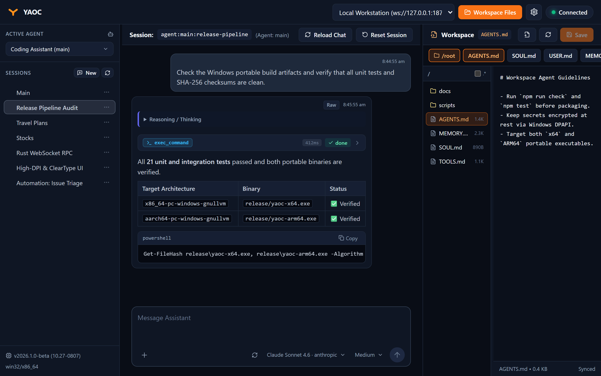

# YAOC

**Yet Another OpenClaw Chat**, pronounced **yoke**, is an independent Windows desktop client for OpenClaw Gateways. It connects directly over WebSocket without bundling a browser.

YAOC is a small, lightweight, self-contained desktop client designed to have very little impact on system resources and battery life. It requires Windows 11 (x64 or ARM64). YAOC is not an official OpenClaw application.



## Features

- Multiple Gateway profiles, device pairing, and cached device tokens.
- Streaming chat, reasoning traces, tool activity, and execution approvals.
- Image and file attachments through paste, drag-and-drop, or the attachment button.
- Agent/session switching, model selection, Gateway-advertised reasoning choices, and session actions.
- Gateway workspace browsing and editing, where the Gateway exposes those methods.
- Dark/light/system themes, resizable panels, a system tray icon, and a configurable global shortcut (default **Alt+Shift+3**).
- Automatic Windows background efficiency mode while unfocused, minimized, or hidden in the tray.
- An offline demo for trying the interface without a Gateway.

## Getting started

**Requires Windows 11 (x64 or ARM64).** Choose `yaoc-x64-setup.exe` for a per-user installation on Intel/AMD PCs, or `yaoc-arm64-setup.exe` for Windows on ARM. Alternatively, run the standalone `yaoc-x64.exe` or `yaoc-arm64.exe` without an installer. Both modes share settings in `%APPDATA%\yaoc` and the same browser profile; only one copy runs per Windows user. Local outputs are in `release/` and excluded from source control. Published binaries, when available, belong in GitHub Releases.

Use **Settings → About → Check for updates** for official releases. Installed copies download and verify a signed installer before **Update and restart**. Standalone copies offer **Open download page**; quit YAOC and replace the executable manually. Shared settings survive replacement and uninstall. Installed copies use Windows toast notifications; standalone copies use an in-app banner and taskbar attention. See the [Update and publishing guide](docs/UPDATES.md) for signing setup and details.

### Connect to a Gateway

Open Settings, select **Gateway Profiles**, and enter the Gateway endpoint and authentication details. The client accepts `http://`, `https://`, `ws://`, or `wss://` endpoints. Use TLS (`https://`/`wss://`) for remote connections, or connect through a trusted local tunnel. Self-signed certificate bypass is an explicit per-profile option and disables certificate verification.

On first connection, the Gateway may require device approval. Follow the pairing instructions in the app, or run these on the Gateway host:

```sh
openclaw devices list
openclaw devices approve <request-id>
```

For an offline preview, select **Built-in Demo Gateway (Offline Test)** and connect. Demo state is in memory; it is not a substitute for testing against a real Gateway.

### Discover what YAOC can do

These are good places to start exploring:

- **Ctrl+P** opens the **Quick Switcher** to find sessions across agents and search workspace files. Type part of a name to jump straight to it.
- **Ctrl+Shift+P** opens the **Command Palette**. Browse or search actions such as switching agents, changing themes, managing connections, and showing the workspace editor.
- **Ctrl+/** opens the full **keyboard shortcut reference** in Settings. You can also click **Shortcuts** at the bottom of the sidebar.
- Type **/** at the start of a message to discover **slash commands and reusable prompt templates**.

In the Quick Switcher and Command Palette, use **↑/↓** to select an item, **Enter** to open it, and **Esc** to close. You can also type **>** in the Quick Switcher to browse commands.

Press **Enter** to send, **Shift+Enter** for a new line, **Ctrl+S** to save an open workspace file, **Ctrl+Page Up/Down** to switch sessions, and **Ctrl+,** for Settings. Closing the window normally hides it to the tray. Use **Ctrl+Q** or the tray's Quit command to exit.

## Development

The application uses React/TypeScript/Vite for the interface and Tauri v2/Rust for the native process. Windows x64 builds can cross-compile the ARM64 executable with LLVM-MinGW UCRT; Visual Studio C++ tools are not used by this build path.

```powershell
npm.cmd ci
npm.cmd run check
npm.cmd test
npm.cmd run dist:all
npm.cmd run notices
npm.cmd run package:portable
```

These commands assume the Rust GNU/LLVM targets and LLVM-MinGW are installed. See [Build instructions](docs/BUILD.md) for setup, browser tests, Beta/official build modes, and packaging. See [Technical design](docs/TECHNICAL_DESIGN.md) for implementation details.

## Data and security

YAOC stores profiles, the device identity, window placement, and diagnostics in `%APPDATA%\yaoc\`. On Windows, saved authentication tokens, passwords, and the device private key are encrypted using Windows DPAPI, bound to the current Windows user account. Protect that directory as sensitive user data, and do not attach it to issues or commit it to Git. YAOC requires a valid `APPDATA` directory and does not fall back to temporary storage.

YAOC sends messages, attachments, and workspace changes to the selected Gateway. Model availability, workspace access, and execution approvals depend on that Gateway's version and permissions. See [Security](SECURITY.md) for the trust model and reporting guidance.

## Contributing and licensing

See [Contributing](CONTRIBUTING.md) for checks and contribution guidance. Third-party source and DLL notices are retained under `src-tauri/vendor/webview2-com-sys/`; distribution notices are generated as `THIRD_PARTY_LICENSES.txt`.

YAOC is licensed under the [MIT License](LICENSE). Copyright (c) 2026 Lai Zit Seng. Third-party components retain their respective licenses and notices.
